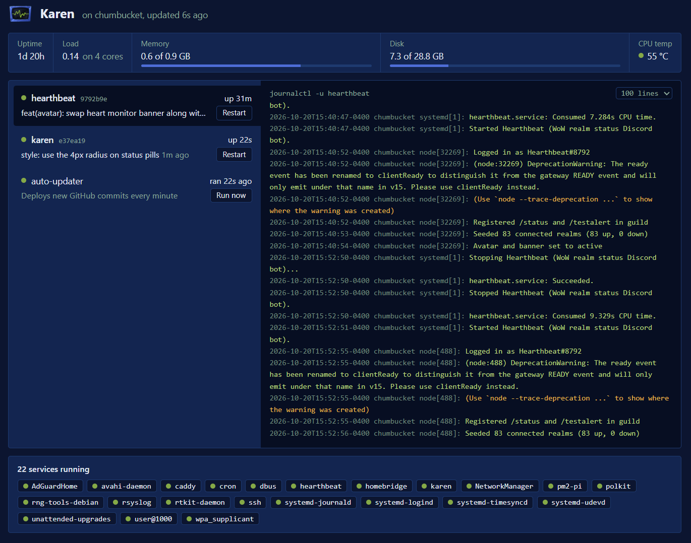

# Karen

A dashboard and auto-updater for a Raspberry Pi. Karen runs on the Pi, serves a page to your home network, and deploys new GitHub commits for the projects you list in `projects.json`.



The page shows:

- **System**: uptime, load, memory, disk and CPU temperature.
- **Projects**: each project's service state, deployed commit, and whether GitHub has a newer one, with a **Restart** button. Select a project to read its log on Karen's screen beside the list.
- **Auto-updater**: when it last ran, its log, and **Run now** to check GitHub immediately.
- **Services**: every systemd service that is running or has failed.

The page refreshes every 10 seconds. Karen has no npm dependencies.

## Install

Needs Node 18.17 or newer and systemd.

```bash
git clone https://github.com/lolswirl/karen.git ~/karen
cd ~/karen
bash install.sh
```

Open `http://<pi hostname>.local:8080` from any device on your network. To use another port, run `KAREN_PORT=9000 bash install.sh`.

`install.sh` sets up:

| What | Purpose |
| --- | --- |
| `karen` service | Serves the page. Starts on boot. |
| `karen-update` timer | Runs `update.js` every minute. |
| `/etc/sudoers.d/karen` | Allows exactly `systemctl restart <service>` for each project and `systemctl --no-block start karen-update.service`, nothing else. |
| `systemd-journal` group | Added to your user if needed, so Karen can read logs. |

## Projects

```json
[
  { "dir": "~/hearthbeat", "service": "hearthbeat" },
  { "dir": ".", "service": "karen" }
]
```

| Field | Meaning |
| --- | --- |
| `dir` | The project's git checkout, whose folder name is shown in the list. `~` is your home folder; other relative paths start from this repo, so `"."` is Karen. |
| `service` | The systemd service that runs it. |

Each minute the updater fetches `main` for every project. When there's a new commit, it resets the checkout to match GitHub, runs `npm ci --omit=dev` if there's a `package-lock.json`, and restarts the service. Local edits to tracked files are discarded. Untracked files such as `.env` are kept.

To add a project:

1. Clone it on the Pi and set it up as a systemd service.
2. Add it to `projects.json` and push. The updater picks up the new list within a minute.
3. Run `bash install.sh` on the Pi once, so the sudoers rule covers the new service.

## Security

There's no login: anyone on your network can view the page and press its buttons, so don't expose the port to the internet. The buttons require a custom request header, so other websites open in your browser can't trigger them.

## Uninstall

```bash
sudo systemctl disable --now karen karen-update.timer
sudo rm /etc/systemd/system/karen.service /etc/systemd/system/karen-update.service /etc/systemd/system/karen-update.timer /etc/sudoers.d/karen
sudo systemctl daemon-reload
```
